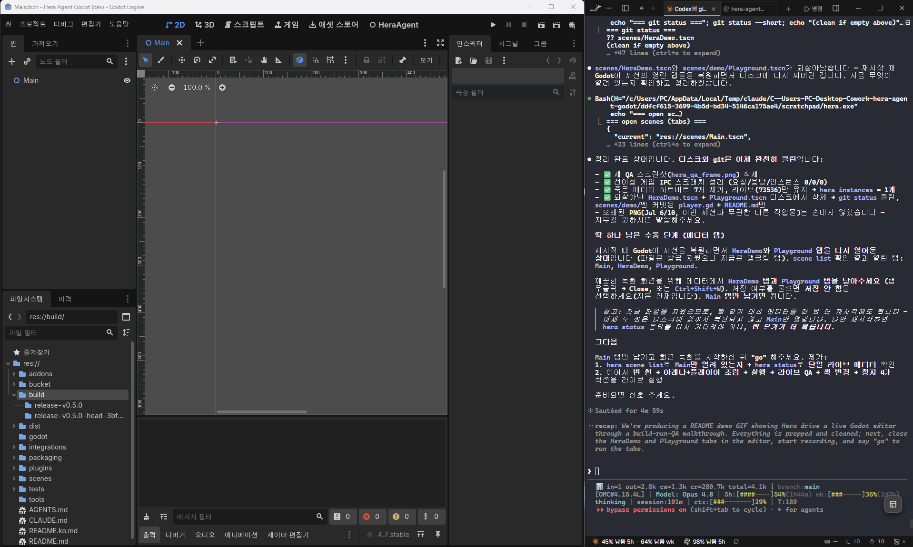

<p align="center">
  
</p>

# hera-agent-godot

The editor panel shows bilingual connection, version, C# and auth
observations, with theme/DPI-aware layout and English **Copy agent setup**.
Version matching compares major/minor; it does not prove feature compatibility.
The copied block includes the project path but never token values or token paths.
See [development validation](docs/releases/v2-development-validation-2026-10-16.md).

**CLI command migration:** this checkout installs `hera-godot`, with
`hera-agent-godot` retained as an alias. It no longer registers `hera`, so other
tools can use that name. Published packages/Homebrew may still expose the old name
until separately released. See [migration notes](packaging/README.md#command-name-migration).

**English** · [한국어](README.ko.md)

> Hera gives agents eyes, hands, and proof in the live Godot editor.

## Watch the v2.0.2 demo

Codex builds and QA-tests a C# tower defense game in a live Godot editor with Hera.

https://github.com/user-attachments/assets/0f37c092-8223-449f-88d5-32efeb27d509

[Watch on YouTube](https://youtu.be/1YSc7_Q_Djc)

<p align="center">
  
</p>
<p align="center">
  <em>Assembled, ran, and QA-tested a live Godot game entirely from the shell — build the scene, run it, read the moving player, inject input and verify the game reacts, recolor a running node. The whole session is <strong>~1,170 tokens</strong> of tool output: compact JSON by default, no tool-schema preload.</em>
</p>

A **low-token CLI** that lets AI coding agents inspect and control a **live
Godot 4.7+ editor** in real time — read the output/errors, run a scene, walk and
edit the node tree, evaluate C# or explicit GDScript expressions, and more. The agent acts on the *real*
editor and checks the result instead of guessing from stale training data.

**Why a CLI, not MCP?** Godot already has a healthy MCP-addon ecosystem — Hera
makes the opposite bet on purpose. MCP servers pay for breadth in tokens: dozens
to 100+ tool schemas plus verbose JSON responses sit in the agent's context
every turn. Hera delivers **MCP-grade reach over the live editor as a
compact-JSON-by-default CLI** — one command per action, minimal tokens, and it
works with anything that can run a shell command (pipes, `batch`, CI, any
agent), not just MCP clients.

The product identity is intentionally simple: **live editor truth, low-token
control, proof-first QA**. See [docs/IDENTITY.md](docs/IDENTITY.md) for the
language and design principles that keep new features aligned.

Sibling of [`hera-agent-unity`](https://github.com/NotNull92/hera-agent-unity) —
same low-token, shell-native philosophy, **designed for Godot**, not ported.

## Current in-repo baseline: v2.0.3

Docs: the release now carries [Hera Godot Status](docs/guide/index.html), a
self-contained Korean guide to the request flow, commands, risks and decisions.
Unreachable Go helpers were removed; CLI and addon behavior are unchanged.
Addon manifest and GitHub Release are `2.0.3` (2026-10-21). Scoop, npm and
Homebrew follow the verified release hashes.
[Release/channel record](docs/releases/v2.0.3-release.md).

`v2.0.0` changes the default eval language to C# and adds C# validation/run and
the bilingual editor panel. Existing stable JSON field types remain unchanged.

Highlights since v1.1.0:

- **Command name:** use `hera-godot`; `hera-agent-godot` remains available. New installs do not register `hera`.

- **Mutation gate:** overlapping editor writes fail `editor_busy`; batches keep
  ownership through import.
- **Operation receipts:** `operation submit|status|cancel` for guarded node set
  and session-targeted game set/call. Pre-dispatch refusals are
  `rejected`/`not_applied`.
- **Guarded node sets:** `--expected` / `--snapshot` / `--verify` refuse stale
  observations before the setter.
- **Editor-log evidence:** `output`/`diagnostics --source editor` with cursors.
  File logs omit the default `source`; editor logs retain `source: editor`.
- **Linked evidence:** opt-in `--evidence` on captures, save, and script
  validate. See [linked evidence](docs/COMMANDS.md#linked-evidence-opt-in).
- **Compact defaults:** `status --capabilities`, `operation --verbose`,
  `--ids` on `game ui tree`.

Upgrade the CLI and addon together and fully restart Godot. The v1 compatibility
promise remains [docs/CONTRACT.md](docs/CONTRACT.md).

## Nonvisual CI (configured tier)

The [nonvisual CI recipe](docs/HEADLESS_CI.md) defines a pinned, **Godot 4.7-only**
nonvisual lifecycle: static script checks stay headless; the live editor and
game run inside an isolated virtual display so the deterministic runtime-logic
scenario can execute. It excludes screenshots, visual UI, renderer output, and
window/input claims, and does not extend live runtime coverage to Godot 4.2–4.6.

Remote GitHub Actions verification passed on 2026-07-13 at commit
[`5c0ba65`](https://github.com/NotNull92/hera-agent-godot/commit/5c0ba6562961a6a11ab581d0f4eab440d34ce008).
The [successful run](https://github.com/NotNull92/hera-agent-godot/actions/runs/29256396824)
includes the nonvisual editor→game lifecycle and its requirement-covered
runtime-logic scenario.

## Low-token, measured

The "MCP-grade reach, fewer tokens" claim — with numbers:

| | Hera (CLI) | Godot MCP servers (~41–155 tools) |
|---|---|---|
| Tool schemas resident **per turn** | **0** | ~4k–31k tok (grows with tool count) |
| Surface the agent loads | cacheable markdown (live-editor skill ~1k tok; full COMMANDS.md is larger) | full tool list, re-sent each turn |
| Per-action response | compact JSON — default `status` ≈50 tok (fixture), `node get` ≈186 tok | JSON, often pretty |

Hera figures are **measured** on a live Godot 4.7 editor; the MCP column is an
**estimate** from sampled public Godot MCP tool counts (~41–155 tools) ×
~100–200 tok per tool schema. Method, caveats, and a reproducer:
**[docs/LOW_TOKEN.md](docs/LOW_TOKEN.md)**.

## Command surface

The `v2.0.0` CLI/addon surface includes:
`status` (`--capabilities`), `operation`, `instances`, `run`/`stop`, `scene`, `editor`, `script` (including
`validate` and `.gd`/`.cs` create), `project`,
`classdb`, `node` (read + write + reparent + resource/script wiring), `signal`, `resource`
(get/uid/list/set/create/resave/update-uids/export-mesh-library), `theme`
(get/set for `Theme` resource items), `game`
(runtime inspect + UI audit + clock + input + joypad/axis + sequence + input-log + set/call/click + assert + QA +
screenshot), `guidance`, `game_feel`, `output`, `diagnostics`, `eval`, `screenshot`
(capture + local before/after `diff`),
`batch`, and `smoke`, with
`--json`/`--ids` output modes. See
[docs/COMMANDS.md](docs/COMMANDS.md) for the command reference and
[docs/ROADMAP.md](docs/ROADMAP.md) for release history and Asset Store
packaging status.

For smaller reads, use `node get <path> --changed`, `scene tree [path] --depth N
--type Class --props a,b`, or `signal list <path> --connected`. Defaults are unchanged.

For conditional edits, read `node get <path> --prop P --snapshot`, then pass
its `expected` object to `node set <path> --prop P --value V --expected '<JSON>'
--verify`. Stale sessions, scenes, nodes, or typed values are rejected before
mutation. See [conditional changes](docs/COMMANDS.md#conditional-node-property-changes).

For response-loss recovery, explicit `operation submit <id> --request JSON` wraps
guarded node sets or runtime set/call; `operation status|cancel <id>` inspects or
cancels queued work. Same-ID retries do not repeat retained operations. Records
are bounded and lost on restart. See [operation receipts](docs/COMMANDS.md#operation-receipts-experimental).

Overlapping mutations and sensitive reads fail immediately with `editor_busy`.
Status, operation status/cancel and buffered editor logs remain available. Batch
shares ownership across its children; client timeouts do not unlock running work.
See [the editor gate](docs/COMMANDS.md#editor-mutation-gate) for import readiness
and engine capability limits.

v2.0.0 adds an **engine-backed surface** that needs no open
editor: `engine info`/`doctor`, `script run` (headless `SceneTree` harness with
passthrough args), `project import`, `project export` (`pack` needs no export
templates; `release`/`debug` warn when standard templates are missing),
`capture movie` (deterministic Movie Maker frames), `perf sample` (engine
benchmark phases), `docs dump` (engine or project API reference), and
`classdb dump` (offline ClassDB JSON). They take the engine from
`--engine <path>`, `HERA_GODOT_ENGINE`, or `GODOT_BIN`, bound it with
`--timeout`, and never parse engine stdout for status. See
[engine-backed commands](docs/COMMANDS.md#engine-backed-commands-no-live-editor).

Capture and docs generate in isolated directories before publishing verified artifacts. Failed runs retain `staging_dir`; `published:true` confirms publication. Debug commands discover threads; use `--thread ID` when selection is ambiguous. Native termination and close use bounded caller waits and report incomplete cleanup.


`hera-godot status` reports the editor PID, scene, project name, engine version,
and Game Feel / C# editor flags. Session and project-path fields are omitted.
The planned 2.1 CLI trims redundant response fields in compact, pretty and batch
output; see [the breaking-change migration table](docs/MIGRATING_TO_V2_1.md).
`hera-godot status --capabilities` adds the engine commit and API capability states
(`supported`, `unsupported`, or `unverified`). API presence does not certify a
connected debugger or installed SDK. See
[the command reference](docs/COMMANDS.md) and [capability scope](docs/ARCHITECTURE.md#6-discovery--instance-files).

Read editor-session logs with `hera-godot output --source editor` or
`hera-godot diagnostics --source editor`. Reuse the returned `cursor` with `--since`
to inspect a later interval. This requires a verified registered collector;
unavailable evidence and expired cursors are explicit. The bounded buffer
reports dropped history and covers only this editor after registration.
File logs remain the default; startup `--log-file` capture stays separate.
See [editor log evidence](docs/COMMANDS.md#editor-log-evidence).

Check on-disk GDScript with `hera-godot script validate res://Player.gd`.
Validation uses the connected editor's engine in a bounded headless process,
prints the engine output as JSON, and exits nonzero on failure. It does not
certify warning-free code; loading dependencies can execute code. `.cs` validation
uses an isolated .NET project build with a 60-second default (see the C# guide).
Replay input actions with `hera-godot game input sequence --file events.json`, where
the array contains `{ "frame": 0, "action": "ui_accept", "pressed": true }`
events. Frames are relative physics frames; held actions are released on exit.
See the command reference for timing limits and QA examples.

Choose GDScript or C# by the script filename: `hera-godot script create res://Player.gd`
or `hera-godot script create res://Player.cs --ready --export Speed:float=3.5f`.
Optional `--lang gdscript|csharp` must agree with the extension. C# creation,
opening, and attachment require Godot .NET; `status.csharp_supported` reports
editor support, not whether the .NET SDK is installed. Build and reload the C#
assembly before attaching a new script. Hera never generates solution files;
C# validation redirects build outputs away from editor artifacts. C# inspection
reflects the loaded assembly, which may be stale. `eval` now defaults to C#;
use `--lang gdscript` or `HERA_GODOT_EVAL_LANG=gdscript` for old expressions.
New C# eval/validate/run require Godot 4.7+ .NET. The small native C# eval loader
is entirely `#if TOOLS` and excluded from export builds. The editor bridge
remains GDScript. Build the separate helper using the C# guide below; release
asset is installed with `hera-godot csharp-host install`. See [migration](docs/MIGRATING_TO_V2.md).
See [C# support](docs/CSHARP_SUPPORT.md) for setup and limitations.

Externally launched and parallel game processes can be selected independently
from the editor: list them with `hera-godot game instances`, then use
`hera-godot --instance <EDITOR_PID> game --pid <GAME_PID> tree` (or any other game/QA
subcommand). Without `--pid`, editor-play selection remains the default and
ambiguous targets still fail. `--instance` and `--pid` select processes; they
do not isolate `user://` save files. Runtime screenshots report the live
viewport size and are not upscaled to the project resolution. Expired editor
heartbeats show up as `stale` on `hera-godot instances` instead of looking like a
missing editor. The Hera runtime inspector stays available for editor play but
is removed from exported project settings.

## Install

For v2.0.0 upgrades, update scripts to `hera-godot` and verify with `hera-godot version`. npm upgrades remove the old package bin; one-line installers preserve existing `hera` files. Check the resolved path and ownership before manually removing an old Hera Godot `hera`; another tool may own it. Upgrade CLI and addon together. Homebrew migration awaits a separate tap update.

**CLI** — via a package manager:

```powershell
# Windows (Scoop)
scoop bucket add hera-agent-godot https://github.com/NotNull92/hera-agent-godot
scoop install hera
```

```sh
# macOS / Linux (Homebrew)
brew install NotNull92/hera/hera
```

```sh
# Any platform with Node.js 18+ (npm)
npm install -g hera-godot
# or zero-install: npx hera-godot status
```

Or a one-liner that fetches the latest release binary:

```sh
# macOS / Linux
curl -fsSL https://raw.githubusercontent.com/NotNull92/hera-agent-godot/main/install.sh | sh
```

```powershell
# Windows (PowerShell)
irm https://raw.githubusercontent.com/NotNull92/hera-agent-godot/main/install.ps1 | iex
```

Set `HERA_VERSION` to pin a tag and `HERA_BIN_DIR` to change the target dir. Or
build from source: `go build -o hera-godot .` (Go 1.25+). Check it with `hera-godot version`.
Windows winget distribution is intentionally retired: no winget-pkgs submission
exists or is planned. See the recorded decision in
[`packaging/README.md`](packaging/README.md).

**Addon** — download `hera-agent-godot-addon.zip` from the
[latest release](https://github.com/NotNull92/hera-agent-godot/releases/latest),
unzip it into your Godot project root (creating `addons/hera_agent_godot/`), and
enable it under **Project → Project Settings → Plugins**.

## Agent integrations

Each kit gives an agent one compact Hera workflow instead of a large tool
schema. Install the CLI and enable the addon first.

- **Claude Code:** inside Claude Code, add this repository as a marketplace and
  install the plugin:

  ```text
  /plugin marketplace add NotNull92/hera-agent-godot
  /plugin install hera-godot@hera-agent-godot
  /reload-plugins
  ```

  The `live-editor` skill auto-invokes for Godot editor work; invoke it directly
  as `/hera-godot:live-editor` when desired. To test a local checkout without
  adding a marketplace, run
  `claude --plugin-dir ./integrations/claude-code/hera-godot`.
- **Codex:** inside a terminal, add this repository as a Codex plugin
  marketplace and install the plugin:

  ```text
  codex plugin marketplace add NotNull92/hera-agent-godot
  codex plugin add hera-godot@hera-agent-godot
  ```

  The bundled `live-editor` skill auto-invokes for Godot editor work. To test a
  local checkout, run `codex plugin marketplace add <checkout-dir>` and remove
  it afterwards with `codex plugin marketplace remove hera-agent-godot`.
- **Cursor:** copy
  [`integrations/cursor/hera-godot.mdc`](integrations/cursor/hera-godot.mdc)
  to `<your-project>/.cursor/rules/hera-godot.mdc`. It is an Agent Requested
  project rule, so Cursor loads it when live Godot work is relevant.
- **Other coding agents:** append
  [`integrations/AGENTS.md`](integrations/AGENTS.md) to the target project's
  `AGENTS.md`.

The `AGENTS.md` driver card targets about 1k tokens. Detailed operating rules
live in [the agent guide](docs/AGENT_GUIDE.md), and the full command reference
is loaded as needed. Claude Code and Codex share the same `live-editor` skill.

## How it works

```
Go CLI  ──HTTP /rpc──▶  Godot editor addon (@tool EditorPlugin, GDScript)
 (cmd/, internal/)        (addons/hera_agent_godot/)
        ▲                          │
        └── scans ~/.hera-agent-godot/instances/ ◀── Heartbeat
```

- **CLI** (Go): discovers the editor, sends one compact JSON request per command.
- **Addon** (GDScript): runs a localhost HTTP server, executes each request on the
  editor main thread via `EditorInterface`.

See **[docs/ARCHITECTURE.md](docs/ARCHITECTURE.md)** for the full design,
**[docs/COMMANDS.md](docs/COMMANDS.md)** for the command surface, and
**[docs/ROADMAP.md](docs/ROADMAP.md)** for release history.

## Repository layout

```
addons/hera_agent_godot/  the distributable Godot 4.7+ addon (GDScript)
project.godot, scenes/    dev host project — the CLI's run/save/screenshot target
cmd/                      Go CLI commands (status, instances, run/stop, scene, editor, script, project, classdb, node, signal, resource, theme, game, guidance, game_feel, output, diagnostics, eval, screenshot, batch, smoke)
internal/                 client / discovery / protocol
docs/                     ARCHITECTURE, COMMANDS, ROADMAP, release notes, prompt-game guidance
integrations/             compact Claude Code, Cursor, and AGENTS.md harness kits
```

## Requirements

- Go 1.25+ (CLI)
- Godot **4.7+** standard build recommended (addon). Verified minimum is
  **4.2**: the addon loads and answers the CLI on 4.2–4.6 (spot-checked) —
  see [docs/SUPPORT_MATRIX.md](docs/SUPPORT_MATRIX.md).

## Security

Undoing node removal or reparenting restores descendant scene ownership. Resource/theme edits
validate all requested values before applying them. Runtime UI targeting and
audit use viewport coordinates, including canvas and camera transforms.
Scenario QA rejects unreadable diagnostics; omitting `max_warnings` allows
warnings, while an explicit `0` requires none. QA run steps wait for the requested
play/stop state; state-only reads return immediately.

The bridge binds `127.0.0.1` only and rejects browser-origin requests.
Optional shared-token auth locks it to clients that know a secret
(`~/.hera-agent-godot/token` or `HERA_AGENT_GODOT_TOKEN`). Threat model and
setup: [docs/SECURITY.md](docs/SECURITY.md).
An existing token that cannot be read prevents bridge startup. HTTP replies use
bounded partial writes with a separate five-second write deadline.

## Sibling: hera-agent-unity

Working in Unity too? [**hera-agent-unity**](https://github.com/NotNull92/hera-agent-unity)
brings the same low-token, shell-native philosophy to the **Unity Editor** — read
console errors, run C#, enter Play Mode, manage GameObjects, build UI, and run
tests, all in compact, agent-friendly output. Across both engines, your agents
get one consistent way to drive each.

## Support

Hera is free and MIT-licensed. If it saves you time, you can support development:

[Join the Discord community](https://discord.gg/QBzEVuYwK)

[](https://ko-fi.com/notnull92)

## License

MIT — see [LICENSE](LICENSE).

C# helper / C# 헬퍼: `hera-godot csharp-host install --version v2.0.3`
(npm/Scoop/Homebrew install only the CLI / 패키지 매니저는 CLI만 설치).

Node creation supports repeatable `--set prop=value` on `node add` and `node instance`, with one undo action and re-read `values`.

`game assert ... --within-ms N` retries until success or a deadline of at most 30 seconds; QA assertion steps accept `within_ms`.
