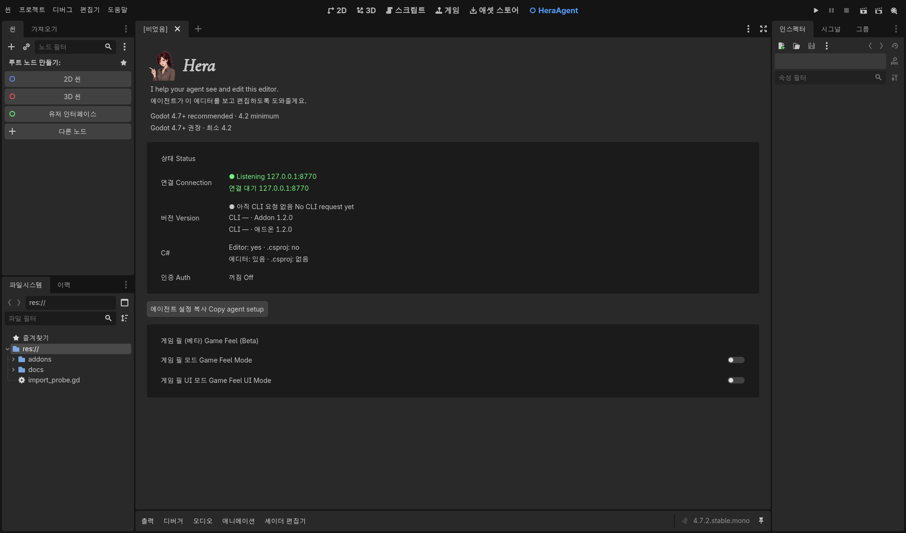
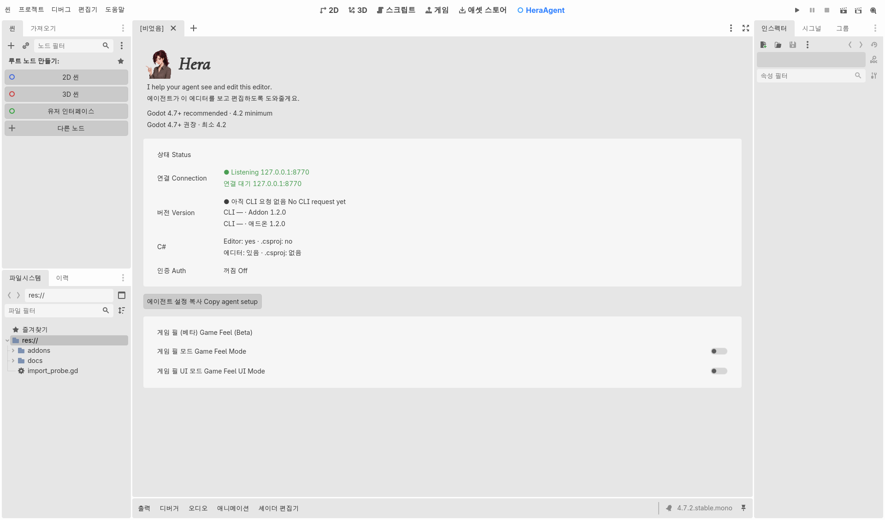
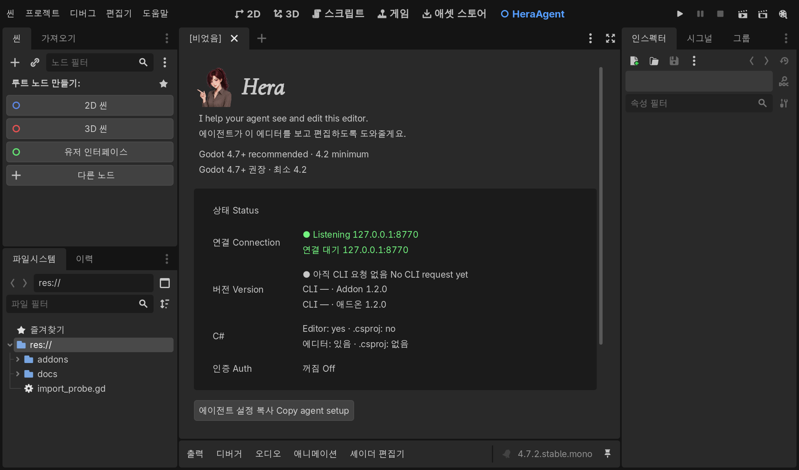
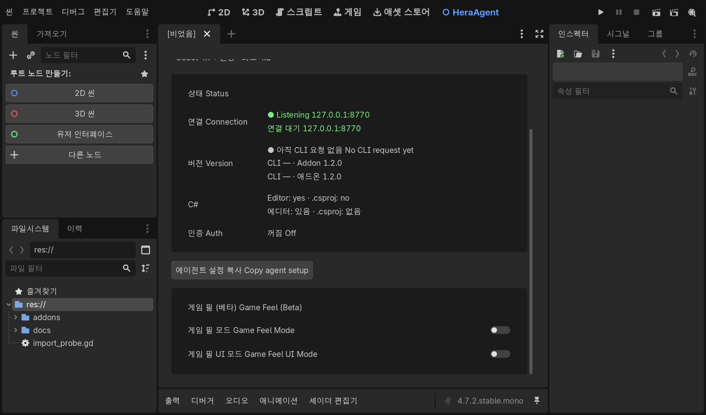
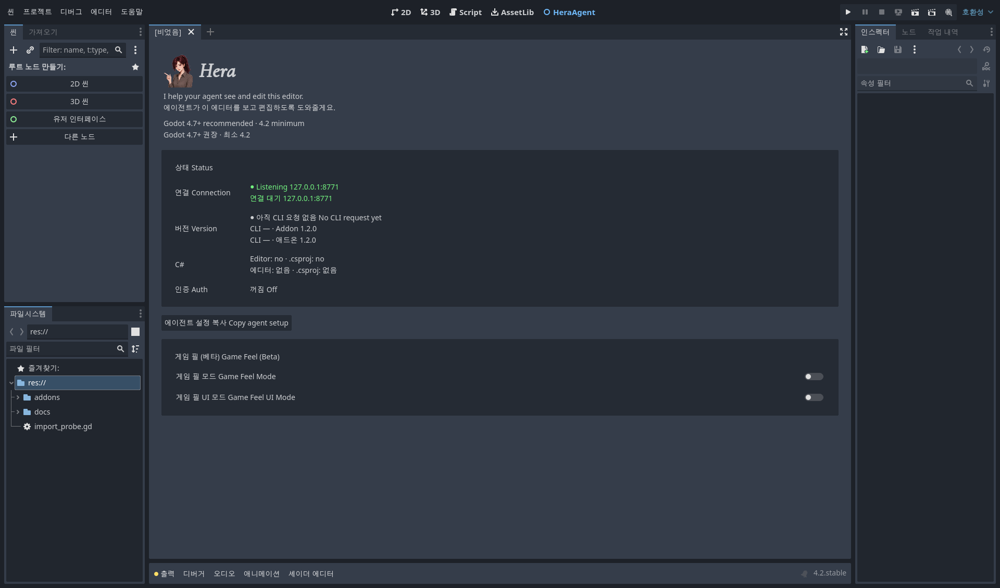

# W2 editor UI and integration evidence — 2026-10-16

Scope: finish Phase 6 on `feat/v2-editor-ui` from `b5982dd`, then Phase 7
documentation and authorized Phase 8 local gates. W1 fixes `92dff85..b5982dd`
are inherited. PLAN was read, never edited or staged. No version bump, release,
PR, CI configuration change or user project edit was performed.

## Implemented and reviewed

- Four read-only status rows, major/minor comparison, explicit unknown legacy
  headers, patch difference note, native C# editor/root-project observations.
- Auth read failure stays unknown rather than falsely Off; bind failure retains
  the successfully read auth state. Copy contains English guidance and project
  path but no token value/path/environment value. Real clipboard and two-second
  feedback checked, then the previous clipboard restored.
- Theme lookups replace brand colors; theme notifications repaint. Editor scale
  controls spacing and title size. Cormorant applies only to Hera. All visible
  panel strings use the EN/KO dictionary. Existing Game Feel settings remain.
- Tests cover dictionary completeness, section order, version cases, secret
  exclusion, auth failure, unchanged settings keys and live theme notification.

## Local results

Windows x64; standard 4.2 and 4.7, .NET 4.7.2; .NET SDK 10.0.204.
Fixtures use owned temporary projects and isolated user/config directories.

| Gate | Result / retained decisive evidence |
| --- | --- |
| Go | gofmt clean; build, vet, test -count=1, test -shuffle=on, test -race -shuffle=on -count=1 all pass |
| All addon GDScript check-only | 59 scripts pass on both 4.2 and 4.7 |
| Panel, HTTP, eval result tests + plugin load | all pass on both engines |
| 4.2 import | 6.548 seconds; `HERA_IMPORT_OK`; exit 0 |
| 4.7 import | 3.120 seconds; exit 0 |
| Standalone regressions | `PASS: 31 standalone Godot regressions` |
| .NET script language regression | `PASS: GDScript, C# creation, assembly metadata, attachment and runtime QaReady` |
| W1 fresh live runner | eval/validate/direct C# run, explicit GDScript, mixed batch, placeholder and same-editor rebuild/reload pass |
| Live CLI smoke | status, scene open, smoke --skip-game (3 steps), explicit GDScript eval=2, diagnostics pass on all three engines |
| Actual GUI | dark, light, 150% scale on .NET 4.7.2; 4.2 panel load and clipboard pass |

Temporary evidence (volatile; decisive results above retained):
`hera-w2-check-8mzptlsa` (4.2), `hera-w2-check-1p1xejip` (4.7),
`hera-csharp-w1-j2d6nh21`, `hera-v2-languages-bx5lrou3/run.log`,
`hera-v2-regressions.log`, `hera-v2-smoke-sgbkx92o` (4.2),
`hera-v2-smoke-acdikqkt` (4.7), `hera-v2-smoke-kzi_ujx3` (.NET),
`hera-v2-smoke-8mglha69` (final legacy/version checks), all under Windows TEMP.
Regression output includes intentional negative-case errors and engine teardown
RID/ObjectDB warnings; PASS is not a zero-warning claim.

## Test corrections and plan discrepancy

Official 4.2 `--help` has no `--import`; that ignored option kept an editor alive.
The new bounded probe waits for filesystem scanning and loads the imported font,
then exits explicitly. Earlier 60-second timeout was not an import measurement.

The panel test uses an ordinary Theme with an injected color: duplicating the
editor's unexposed EditorTheme failed on 4.7 and hung on 4.2. The HTTP backpressure
test now starts its wait from the actual write deadline, not before serializing
32 MiB; the respond latency and deadline assertions remain. The language runner
maps MSYS PID to native WINPID for CLI selection without changing shell cleanup.

Actual v1.1.0 was built from tagged sources in a temporary directory. Its client
does not send the version header, so the live panel correctly says **CLI version
unknown**. A request with `X-Hera-Cli-Version: 1.1.0` separately confirms the live
**Upgrade CLI and addon together** state. PLAN's request to reproduce mismatch
with the actual old CLI conflicts with its specified missing-header behavior;
no version was fabricated. This difference is handed back for acceptance.

## Visual evidence

Images are actual editor viewport captures, not mockups. At 150%, the panel
scrolls vertically and the second capture shows accessible bottom controls.

## Remaining

New remote CI is not established: its workflow only triggers on main push or
PR, both outside this authorization. No macOS/Linux runtime or .NET 8-only
execution was performed. Existing W1 execution/ALC/MSBuild limits remain; local
success does not remove them. Helper release packaging remains separate work.
